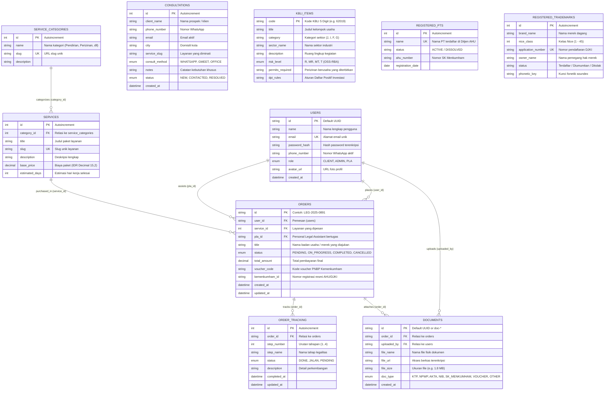

# Entity Relationship Diagram (ERD): LEGALTA

Platform basis data LEGALTA menggunakan **Prisma ORM** sebagai fondasi *Data Modeling & Schema Management* sebelum dialirkan ke **Supabase (PostgreSQL Cloud)**.

---

## 1. Visualisasi Diagram (Mermaid ERD)

---

## 2. Struktur Prisma ORM ([prisma/schema.prisma](file:///e:/Ngodingkan/LegalTA/prisma/schema.prisma))

Skema Prisma telah didefinisikan secara deklaratif dan *type-safe* dengan fitur:
- **Datasource**: PostgreSQL via `DATABASE_URL` (dengan connection pooling pgbouncer di port 6543) dan `DIRECT_URL` (direct port 5432 untuk migrasi DDL).
- **Enums**: `UserRole`, `OrderStatus`, `StepStatus`, `DocType`, `ConsultMethod`, `ConsultationStatus`, `RiskLevel`.
- **Relasi & Referential Actions**:
  - `orders` -> `users` (`onDelete: Restrict`)
  - `orders` -> `services` (`onDelete: Restrict`)
  - `order_tracking` -> `orders` (`onDelete: Cascade`)
  - `documents` -> `orders` (`onDelete: Cascade`)
- **Indeks Unik**:
  - `@@unique([orderId, stepNumber], name: "orderStepUnique")` pada `order_tracking`.
- **Perintah Sinkronisasi**:
  - Generate Client: `npm run prisma:generate`
  - Push Schema ke Supabase: `npm run prisma:push`
  - Seed Data Awal: `npm run prisma:seed`
  - GUI Inspector: `npm run prisma:studio`