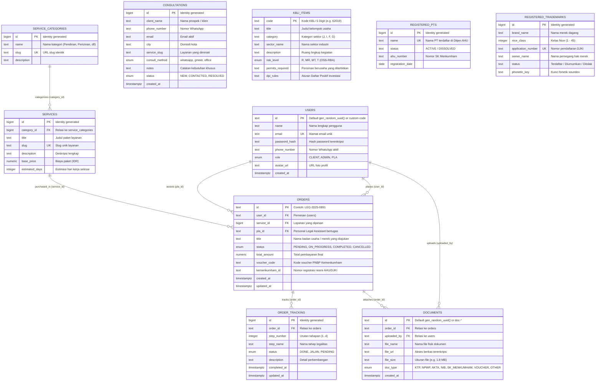

# Entity Relationship Diagram (ERD): LEGALTA

Platform basis data LEGALTA menggunakan **Supabase PostgreSQL** sebagai sistem manajemen basis data relasional di cloud, dengan dukungan skema relasional terstruktur penuh serta pengamanan Row Level Security (RLS).

---

## 1. Visualisasi Diagram (Mermaid ERD)

---

## 2. File Skrip Supabase

- **Skema DDL PostgreSQL**: [database/supabase_schema.sql](file:///e:/Ngodingkan/LegalTA/database/supabase_schema.sql)
  - Berisi seluruh definisi tabel, foreign key constraints, default value, index performa, serta kebijakan **Row Level Security (RLS)** untuk publik dan admin.
- **Data Awal (Seed)**: [database/supabase_seed.sql](file:///e:/Ngodingkan/LegalTA/database/supabase_seed.sql)
  - Berisi data dummy pesanan live tracking (`LEG-2025-0891`, `LEG-2025-0104`, `LEG-2025-0942`), database referensi KBLI 2020, database PT AHU terdaftar, dan database merek DJKI PDKI.